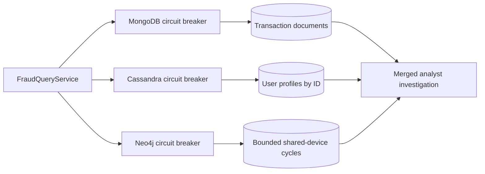

# Hybrid architecture

Clients are pooled once per service run. Independent breakers open after three failures and permit another attempt after ten seconds. Driver/query timeouts and traversal depth/result caps bound requests. Shared-device cycles identify investigation candidates only; household/device-sharing arrangements can produce false positives. No confirmed-fraud conclusion is inferred.

The university query examples are provisional because the faculty reference does not list the assigned three enrollment queries. All three engines execute the same student/course/instructor queries against the same course rosters, and the Python runner asserts equality of result tuples.
